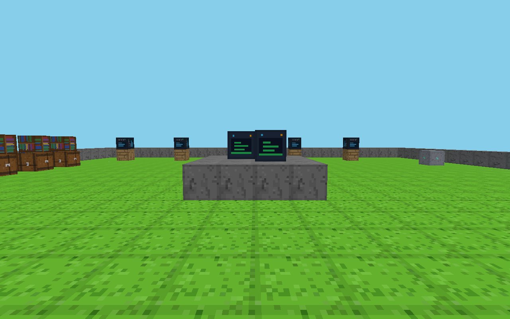
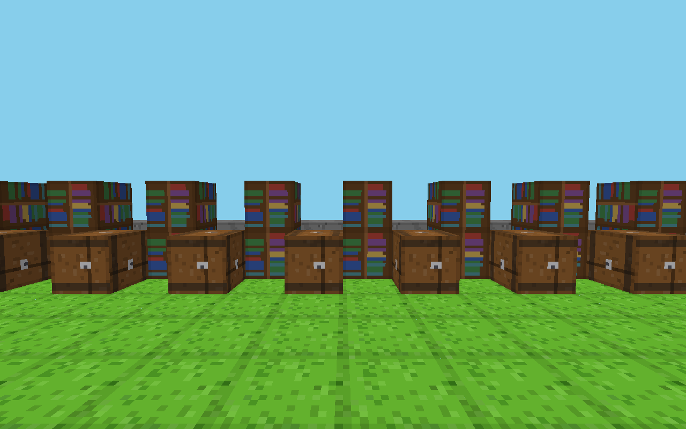
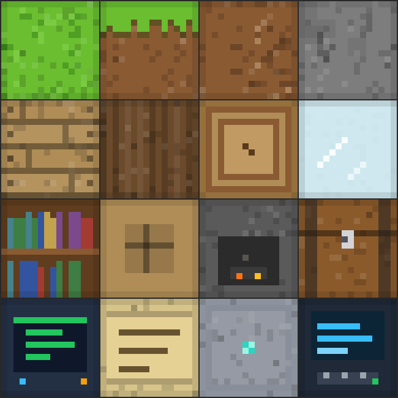
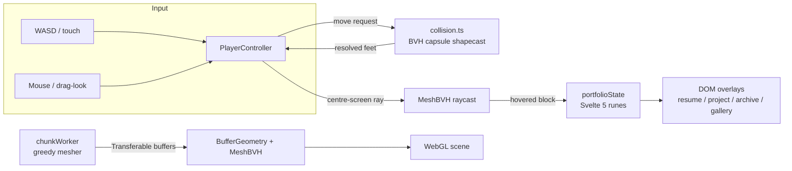

# Voxel Portfolio

A portfolio you walk through: a voxel world in the browser. Spawn in the atrium, explore the library and gallery, and open real projects — Svelte 5, Three.js, BVH collision, worker-meshed chunks, fully keyboard-accessible.

[](https://github.com/enonymous1/voxel-portfolio/actions/workflows/ci.yml) [](LICENSE) [](https://nodejs.org/)

<!-- Hero visual: replace the screenshot below with docs/screenshots/walkthrough.gif
     once a ~10s play session is recorded (spawn → dais → open a panel). Do not
     fake it with a scripted render unless labelled as such. -->


## Why

Portfolio pages are skimmed and forgotten. A walkable one is memorable — and the artifact itself is the skills demo: real-time 3D, worker-side meshing, a payload budget held under 275 KB gz, and dialogs a keyboard user can actually use. No portfolio text lives in the canvas; every block interaction lands in an accessible HTML overlay.

## Non-goals

- **Not a game.** No building, mining, combat, or multiplayer — movement and interaction exist to show work, not to entertain.
- **Not a general voxel engine.** The mesher, collision, and atlas are built for one 32×24×32 world, not as a reusable library.
- **Not a generic template.** The content is one person's real projects; fork it and edit `src/lib/content/portfolio.ts` to make it yours.
- **Not a résumé replacement.** The resume drawer links out to LinkedIn; this site shows the work, it doesn't list every job.

## Quick start

**Prerequisites:** Node `^20.19` or `>=22.12` — older 20.x crashes on startup (`node:util` has no `styleText` export). No API keys, no services, no database.

```bash
git clone https://github.com/enonymous1/voxel-portfolio.git
cd voxel-portfolio
npm install
npm run dev     # http://localhost:5173
```

You should land in the atrium facing the stone dais, two glowing terminals centre-frame. If you see only sky blue, the voxel shader failed to compile — check the browser console (see `src/lib/three/textureAtlas.ts`, which documents the gotcha).

| Action | Desktop | Touch |
|---|---|---|
| Move | WASD / arrow keys | Left joystick |
| Look | Mouse (click to lock pointer) | Drag |
| Open what you're facing | Click, or press E | Tap the prompt button |
| Close a dialog | Esc | Back / close button |
| Jump | Space | — |

**First walk (30 seconds):** walk forward to the dais, click a glowing terminal → the resume drawer opens. Tab cycles inside it; Esc closes and returns focus. Turn left for the library, right for the gallery, north for the workshop.

## Screenshots

The library — bookshelves with book spines, archive chests:



All 16 block tiles are generated procedurally at load (zero image assets) — grass, planks, log rings, bookshelf spines, terminal screens:



## Architecture



<details>
<summary>File map</summary>

| Piece | File |
|---|---|
| Universal reactive state (runes) | `src/lib/state.svelte.ts` |
| Block / tile / zone types | `src/lib/types.ts` |
| Portfolio content (edit me) | `src/lib/content/portfolio.ts` |
| World layout + interactive registry | `src/lib/three/world.ts` |
| Greedy-mesher worker (zero-copy) | `src/lib/workers/chunkWorker.ts` |
| Worker host + BVH geometry | `src/lib/three/VoxelWorld.svelte` |
| Pointer Lock / WASD / raycast | `src/lib/three/PlayerController.svelte` |
| Capsule collision (BVH shapecast, step-up) | `src/lib/three/collision.ts` — test: `npm run test:collision` (`tests/collision.test.mjs`) |
| Gallery GLB loader worker | `src/lib/workers/galleryWorker.ts` — test: `npm run test:gallery-worker` (needs a build first) |
| Gallery models on pedestals | `src/lib/three/GalleryModels.svelte` |
| Model generator + Meshopt pipeline | `scripts/build-models.mjs` (`npm run build:models`) — assets test: `npm run test:gallery` |
| Dialog focus trap | `src/lib/a11y/focusTrap.ts` — test: `npm run test:a11y` (jsdom) |
| DataArrayTexture atlas + shader | `src/lib/three/textureAtlas.ts` |
| Canvas scene + signpost `<HTML>` links | `src/lib/three/Scene.svelte` |
| Hybrid layer (Canvas + overlays) | `src/routes/+page.svelte` |
| Dialogs (resume / project / archive / gallery) | `src/lib/components/Overlays.svelte` |
| HUD + no-3D fallback nav | `src/lib/components/Hud.svelte` |
| Touch joystick + drag-look | `src/lib/components/MobileControls.svelte` |

</details>

## Zones

- **Spawn Atrium** (centre) — podium terminals → Resume drawer
- **Projects Workshop** (north, z≤7) — workstations → project modals (your real projects, pre-filled)
- **Archived Library** (west, x≤6) — bookshelves/chests → DOM list; chests rendered as one `InstancedMesh`
- **Interests Gallery** (east, x≥26) — pedestals → gallery panel; GLB models (Draco/Meshopt) load async
- **Links Gate** (south) — signposts are real `<a target="_blank">` projected with Threlte `<HTML>`

<details>
<summary>Performance &amp; resilience</summary>

- Budget: **decided 2026-10-22 — BVH is kept, budget re-baselined to a 275 KB gz ceiling.** Measured 2026-10-21: ~267 KB gz total for ALL JS+CSS (3D chunk ~234 KB gz; everything else ~28 KB) vs the original <250 KB target. The DDA alternative (~220 KB gz, ~40 lines, no dependency) was considered and *rejected*: BVH has the maintained library/docs/community in the Three.js ecosystem (three-mesh-bvh, actively released) and generalises beyond voxel blocks to the gallery GLB meshes, which a grid-only DDA cannot raycast. Already applied savings: Three aliased to its official min build, `@threlte/extras` aliased to *only* the HTML component (barrel cost +35 KB gz), BVH imported via core subpaths, `nipplejs` dynamic-imported only on touch, GLBs lazy, atlas generated procedurally (0 image bytes), 3D stage dynamic-imported after first paint (DOM/HUD usable before it lands — note SvelteKit still module-preloads the chunk, so it counts in the total above). Treat 275 KB as a regression ceiling in CI, not a goal to grow into.
- Worker mesher verified headlessly against the built bundle: single block → 6 quads, solid 16³ → 6 quads, flat slab → 6 quads with correct top/side/bottom tile layers.
- Raycast: `three-mesh-bvh` (`MeshBVH` + `acceleratedRaycast` + `firstHitOnly`) — logarithmic, not per-triangle.
- Textures: WebGL2 `DataArrayTexture`, one layer per tile, per-layer mipmaps = no atlas bleeding. Worker emits `(u, v, layer)` and UVs scaled by greedy-rect size so tiles repeat, not stretch.
- Context loss: `webglcontextlost` pauses the loop (`renderMode: manual` + state flag) and prevents default; `webglcontextrestored` bumps `rebuildNonce`, re-running the worker and re-uploading geometry.

</details>

<details>
<summary>Phase 2 — BVH shapecast player collision (done 2026-10-22)</summary>

Player is a capsule (r=0.35, h=1.8, feet-based position) resolved against the
voxel mesh's `MeshBVH` via `shapecast` in `src/lib/three/collision.ts`:
closest triangle↔segment points (`ExtendedTriangle.closestPointToSegment` —
plain `THREE.Triangle` doesn't have it) push the segment out by penetration
depth, 3 passes max. Moves are substepped at ≤0.15 m so a lag spike or fast
fall can't tunnel through a 1-block floor. Grounded-only 1-block step-up
(lift → move → settle, with a probe-ahead ledge check) makes the dais,
planks and pedestals walkable while 3-high walls still block; mid-air
rubbing never climbs. Ground snap (0.14 m) via a BVH firstHitOnly down-ray.
Verified headlessly (`npm run test:collision`, 6/6): drop lands at y=1.000,
wall stops at exactly face−radius (9.650), step-up lands on the ledge
(y=2.000, grounded), airborne step refused, ceiling caps at exactly
ceiling−height (1.400), open-ground movement unimpeded. Payload after
Phase 2: ~267.7 KB gz total — still under the 275 KB ceiling.

</details>

<details>
<summary>Phase 3 — Gallery GLB models (done 2026-10-22)</summary>

Real models on the pedestals, replacing the placeholder boxes:
- **Assets:** three procedural models built by `scripts/build-models.mjs` (three.js primitives → merged vertex-coloured geometry → hand-rolled GLB writer): a gantry 3D printer, a 5-unit server rack with LEDs, a d20 on a stand. Sources in `models-src/` (kept OUT of `static/` so they don't deploy).
- **Compression:** gltfpack `-c` → `EXT_meshopt_compression` + `KHR_mesh_quantization`: 22.6 KB → **4.1 KB** (printer), 23.0 → **4.6 KB** (rack), 18.7 → **3.6 KB** (dice). Meshopt chosen over Draco: its decoder is one self-contained module; DRACOLoader fetches WASM from a CDN by default. Regenerate with `npm run build:models`.
- **Loading:** `src/lib/workers/galleryWorker.ts` fetches + parses in a worker (MeshoptDecoder), transfers de-interleaved geometry back; `GalleryModels.svelte` assembles, swaps placeholders per item, rotates displays, and falls back to a main-thread load if the worker errors. Picking/collision stay on the voxel pedestals by design.
- **Bug caught by testing:** gltfpack interleaves position/normal (`InterleavedBufferAttribute`) and writes COLOR_0 as VEC4 — copying `attr.array` wholesale (the obvious code) ships wrong vertex counts and misaligned colours. The worker extracts via `getComponent()` and normalises colour to RGB. Guarded by `npm run test:gallery-worker` (built-bundle test, 5/5) and `npm run test:gallery` (asset decode test, 9/9).
- **Payload accounting (measured):** initial preload ~34 KB gz; + 3D stage ~213 KB lazy; main path total ~262 KB gz JS/CSS (under the 275 KB ceiling); gallery worker is a separate 70 KB gz on-demand script (it carries its own Three copy — the price of worker-side parsing); fallback decoder chunks ~25 KB load only if the worker fails; models 12.4 KB total.

</details>

<details>
<summary>Phase 4 — Focus trap + a11y polish (done 2026-10-22)</summary>

- **Full focus trap** (`src/lib/a11y/focusTrap.ts`, framework-free core + Svelte action): Tab/Shift+Tab cycle inside the dialog, Esc closes with stopPropagation (so PlayerController's global Esc can't double-close — matters for Help, which returns to the previous panel), and focus is *restored* on close to the opener, or to the HUD menu's `[data-focus-fallback]` button when the opener was <body> (the 3D case). Background layers get `inert` while a dialog is open.
- **Overlays refactored** from five duplicated panels to one trapped shell keyed by panel+selection; the backdrop is a real <button> in the tab order; dialog uses `aria-labelledby` to its heading.
- **Polish:** skip link to the portfolio menu, sr-only <h1> for document outline, HUD gains the external links as real anchors (duplicating the 3D signposts for keyboard/AT users), menu targets are 40px, canvas wrapper is no longer aria-hidden (it contains the projected signpost links), gallery rotation respects prefers-reduced-motion.
- **Verified:** `npm run test:a11y` (jsdom, 8/8 — wrap both ways, no mid-list hijack, Esc once + propagation stopped, restore + body fallback) and **svelte-check: 0 errors, 0 warnings** (was 16 warnings, all fixed structurally, none suppressed). Total test suite now 28 checks across 4 scripts, all passing; initial preload ~34 KB gz, unchanged.

</details>

<details>
<summary>Honest limits</summary>

1. Gallery models and the `InstancedMesh` archive chests are display-only — not collidable and not pickable; their underlying voxel blocks handle both. Give them boundsTrees if direct interaction is ever wanted.
2. Gallery models are procedural stand-ins (printer / rack / d20), not artist assets — drop real GLBs into `static/models/`, run them through gltfpack `-c`, and the loader handles them unchanged (geometry-only/textureless assumed; textured models need an ImageBitmap path in the worker).
3. Greedy mesher merges same-tile faces only (correct + simple); texture-per-face blocks merge less — acceptable at this world size.
4. Versions in `package.json` are the current Svelte 5 / Threlte v8-9 line — run `npm install` and let the lockfile pin exacts.

</details>

<details>
<summary>Directory structure</summary>

```
src/
  app.html  app.css
  routes/  +page.svelte (hybrid layer)  +layout.svelte
  lib/
    state.svelte.ts  types.ts
    content/portfolio.ts
    workers/chunkWorker.ts
    three/  Scene.svelte VoxelWorld.svelte PlayerController.svelte
            LibraryInstances.svelte textureAtlas.ts world.ts
    components/  Overlays.svelte Hud.svelte MobileControls.svelte
static/models/   (GLBs go here)
```

</details>

## Tests

```bash
npm run check            # svelte-check: 0 errors, 0 warnings
npm run test:collision   # 6 checks — capsule, step-up, ceiling, tunneling
npm run test:gallery     # 9 checks — Meshopt asset decode
npm run test:a11y        # 8 checks — focus trap (jsdom)
npm run build            # static site in build/
npm run test:gallery-worker  # 5 checks — needs the build first
npm run preflight        # verifies the build output itself (models, chunks, payload ceiling)
```

28 checks across 4 scripts (plus build + preflight), all passing on the release commit.

## Deploy

Static output (`build/`) on any static host — see [DEPLOY.md](DEPLOY.md) for the checklist, host configs (Netlify, Cloudflare Pages, Vercel, nginx), and the 2-minute post-deploy smoke test. Two things to know before you pick a host: Pointer Lock needs HTTPS, and a GitHub Pages *project* site (a subpath like `/voxel-portfolio/`) needs `paths.base` support first because the `/models/*.glb` paths are absolute — a root domain or custom domain needs no change. Hosting is currently deferred; this section only matters when you pick one.
